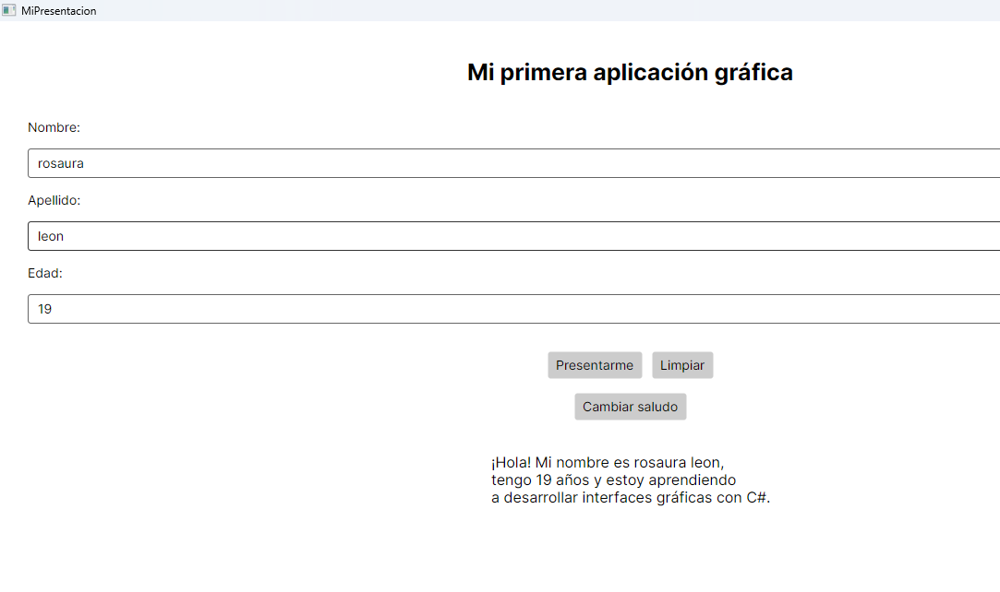
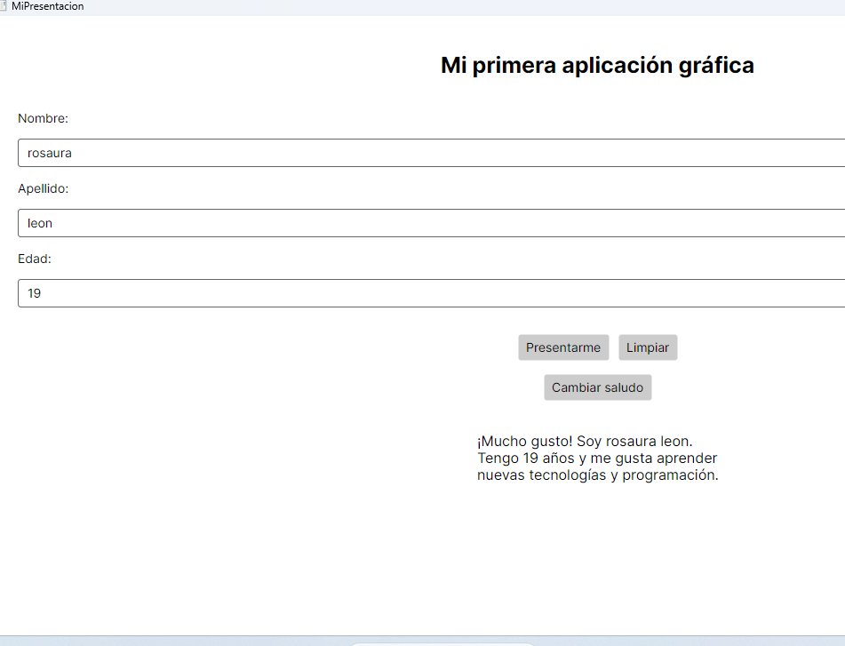
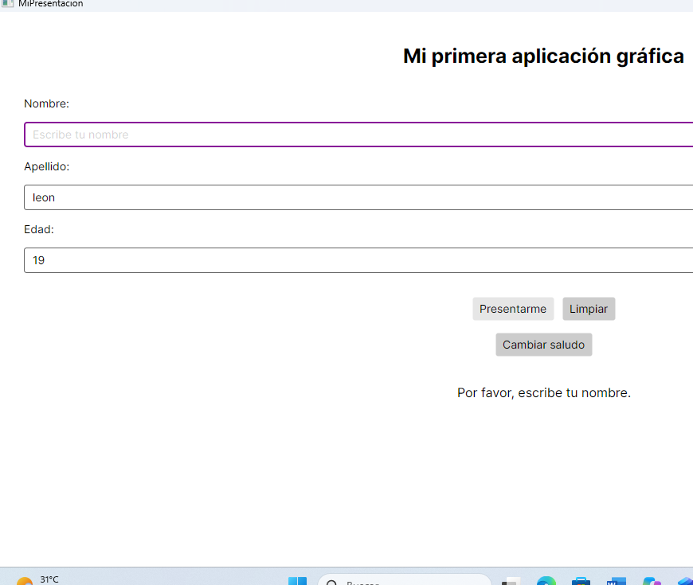
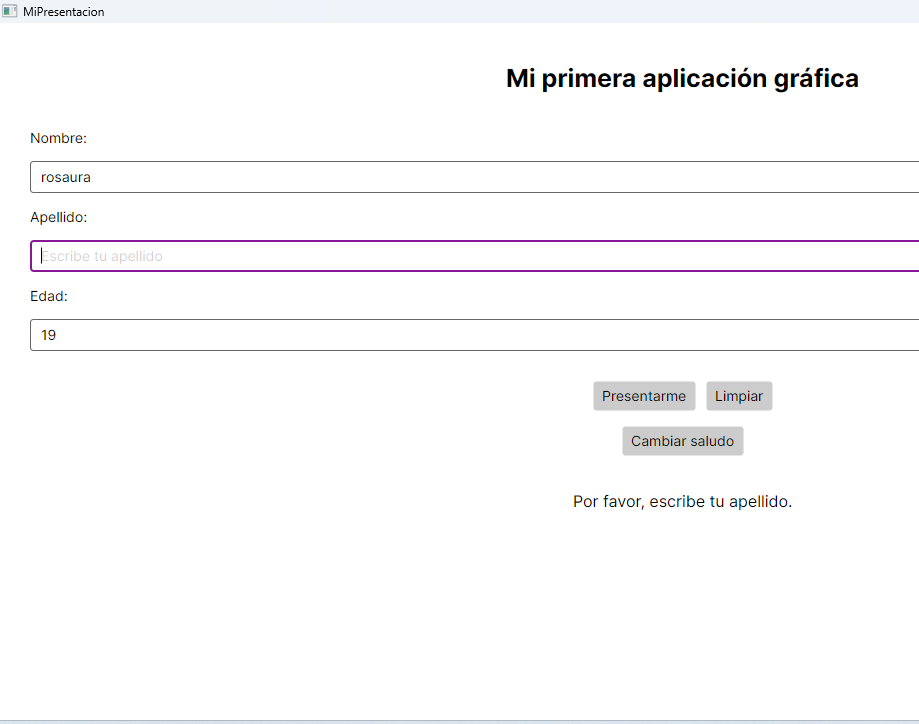
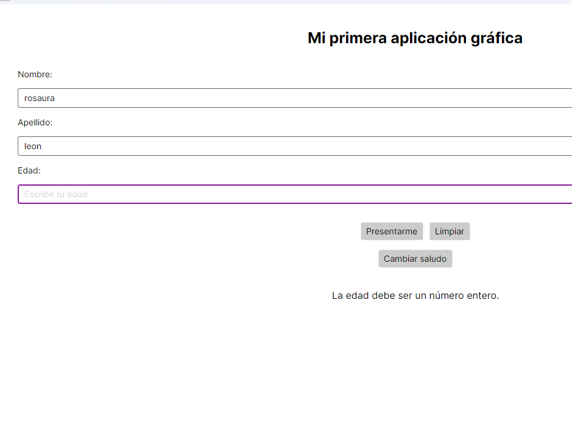

# MiPresentacion

## 1. Descripción del proyecto

Para el desarrollo de este proyecto realicé una aplicación de escritorio llamada **MiPresentacion**, utilizando C#, .NET y Avalonia UI 11. El propósito principal fue construir una interfaz gráfica que permitiera ingresar información básica de una persona, como su nombre, apellido y edad, para posteriormente generar un mensaje de presentación personalizado.

Durante el desarrollo de esta actividad puse en práctica los conocimientos relacionados con la Programación Orientada a Objetos, la construcción de interfaces mediante XAML y la programación orientada a eventos en C#.

A través de este ejercicio aprendí cómo se relaciona la parte visual de una aplicación con el código que permite ejecutar sus diferentes funciones. También trabajé con controles gráficos, identifiqué elementos mediante `x:Name` y programé eventos para que los botones respondieran a las acciones realizadas por el usuario.

Además, incorporé validaciones para comprobar que la información ingresada fuera correcta y evitar que se generaran presentaciones con datos incompletos o incorrectos.

## 2. Objetivo de la aplicación

Con este proyecto desarrollé una aplicación gráfica que permite registrar y procesar información básica de una persona mediante un formulario.

Durante su construcción busqué comprender cómo funcionan los controles visuales, cómo se comunican los archivos XAML y C# y cómo se pueden utilizar los eventos para darle funcionalidad a una interfaz gráfica.

También apliqué diferentes condiciones de validación para comprobar los datos ingresados y proporcionar mensajes de advertencia cuando la información no cumplía con los requisitos establecidos.

## 3. Construcción de la interfaz gráfica con XAML

Para diseñar la ventana principal utilicé el archivo `MainWindow.axaml`, donde organicé los elementos visuales que componen mi aplicación.

Los controles que utilicé fueron los siguientes:

- **Window:** lo utilicé como ventana principal, donde se encuentra toda la interfaz gráfica de mi aplicación.

- **StackPanel:** lo utilicé para organizar los elementos de manera vertical y horizontal, permitiendo distribuir los campos de texto y los botones de forma ordenada.

- **TextBlock:** lo utilicé para mostrar el título de la aplicación, los nombres de los campos y los mensajes que aparecen como resultado de las acciones del usuario.

- **TextBox:** incorporé tres cajas de texto para permitir el ingreso del nombre, el apellido y la edad de la persona.

- **Button:** agregué tres botones para ejecutar las funciones principales de la aplicación: Presentarme, Limpiar y Cambiar saludo.

También utilicé las propiedades `Margin` y `Spacing` para establecer espacios entre los controles y conseguir una mejor distribución de los elementos dentro de la ventana.

Por otra parte, asigné nombres a los controles mediante `x:Name`, lo que me permitió identificarlos y acceder a ellos desde el código C# para obtener la información ingresada y modificar los mensajes mostrados en pantalla.

## 4. Programación de eventos en C#

Después de construir la interfaz gráfica, realicé la programación de los eventos en el archivo `MainWindow.axaml.cs`. En este archivo escribí las instrucciones necesarias para que cada botón ejecutara una acción cuando el usuario interactuara con él.

### 4.1. Botón Presentarme

Para este botón desarrollé el método `Presentarme_Click`, cuya función es obtener los datos escritos en los campos de nombre, apellido y edad.

Primero, programé una validación para comprobar que el nombre y el apellido no estuvieran vacíos ni contuvieran únicamente espacios. Para ello utilicé el método `string.IsNullOrWhiteSpace()`.

Después, utilicé `int.TryParse()` para verificar que la edad ingresada pudiera convertirse en un número entero. También agregué una condición para comprobar que la edad fuera mayor que cero.

Cuando todos los datos cumplen con las condiciones establecidas, la aplicación muestra un mensaje personalizado con el nombre, apellido y edad de la persona. En caso contrario, presenta un mensaje de advertencia indicando qué información debe corregirse.

Con esta función logré que el formulario no solamente recibiera información, sino que también pudiera comprobarla y utilizarla para generar un resultado.

### 4.2. Botón Limpiar

Para este botón programé el método `Limpiar_Click`, que permite restablecer el formulario después de utilizarlo.

Al presionarlo, se borran los datos ingresados en las tres cajas de texto, se restaura el mensaje inicial y se utiliza el método `Focus()` para colocar nuevamente el cursor en el campo del nombre.

Con esta función facilité el ingreso de nuevos datos sin necesidad de cerrar o reiniciar la aplicación.

### 4.3. Botón Cambiar saludo

Como parte del reto adicional del taller, incorporé un botón llamado Cambiar saludo, con el propósito de permitir que la aplicación mostrara dos mensajes de presentación diferentes.

Para desarrollar esta función utilicé una variable de tipo `bool` llamada `saludoAlternativo`, que me permitió controlar cuál de los dos mensajes debía mostrarse.

Cuando el usuario presiona el botón, el valor de la variable cambia y se ejecuta nuevamente el método de presentación para mostrar el saludo correspondiente.

De esta manera, conseguí que el mensaje pudiera cambiar sin cerrar ni reiniciar la aplicación.

## 5. Validaciones y pruebas realizadas

Una vez terminada la programación, realicé diferentes pruebas para comprobar que los botones y las validaciones funcionaran correctamente.

Para ello ingresé diferentes datos en el formulario y verifiqué las respuestas que proporcionaba la aplicación.

Las pruebas que realicé fueron las siguientes:

| Caso | Datos o acción realizada | Resultado obtenido |
|---|---|---|
| 1 | Ingresé nombre, apellido y edad válidos. | La aplicación mostró correctamente la presentación personalizada. |
| 2 | Dejé vacío el campo del nombre. | Apareció una advertencia solicitando ingresar el nombre. |
| 3 | Dejé vacío el campo del apellido. | Apareció una advertencia solicitando ingresar el apellido. |
| 4 | Ingresé letras en el campo de edad. | La aplicación indicó que debía ingresar un número entero. |
| 5 | Ingresé una edad negativa. | La aplicación rechazó el dato y mostró una advertencia. |
| 6 | Ingresé cero como edad. | La aplicación rechazó el dato porque debía ser mayor que cero. |
| 7 | Presioné el botón Limpiar. | Se borraron los campos y se restauró el formulario. |
| 8 | Presioné el botón Cambiar saludo. | El mensaje de presentación cambió correctamente. |

Después de realizar estas pruebas comprobé que las funciones desarrolladas respondían correctamente y que la aplicación cumplía con los requisitos solicitados en el taller.

## 6. Estructura del proyecto

Para organizar el desarrollo de la aplicación trabajé con los siguientes archivos:

- **Program.cs:** contiene el punto de inicio que permite ejecutar la aplicación.

- **App.axaml:** contiene la configuración general y los recursos visuales de la aplicación.

- **App.axaml.cs:** contiene el código asociado a la configuración e inicio de la aplicación.

- **MainWindow.axaml:** contiene el diseño de la ventana principal, donde organicé los campos de texto, los botones, los títulos y los mensajes.

- **MainWindow.axaml.cs:** contiene los métodos programados en C# para controlar los eventos de los botones y realizar las validaciones de los datos.

- **MiPresentacion.csproj:** contiene la configuración del proyecto y las referencias necesarias para su compilación.

- **README.md:** contiene la documentación donde explico el desarrollo, las características y el funcionamiento de la aplicación.

Esta organización me permitió separar la parte visual de la lógica del programa, facilitando el desarrollo y la comprensión de cada archivo.

## 7. Instrucciones para ejecutar el programa

Para comprobar el funcionamiento de la aplicación utilicé la terminal de Visual Studio Code y el comando `dotnet run`.

Los pasos que seguí para ejecutar el proyecto fueron:

1. Verifiqué que estuviera instalado el SDK de .NET.
2. Abrí la carpeta del proyecto en Visual Studio Code.
3. Abrí una terminal ubicada en la carpeta principal del proyecto.
4. Escribí el siguiente comando:

```bash
dotnet run
```

5. Esperé a que el proyecto se compilara y se abriera la ventana de MiPresentacion.

Después de iniciar la aplicación pude ingresar los datos, generar una presentación personalizada, cambiar el saludo y limpiar el formulario.

## 8. Evidencias de funcionamiento

Para demostrar el funcionamiento de la aplicación realicé capturas de pantalla de las diferentes pruebas que ejecuté.

Las evidencias se organizaron de la siguiente manera:

**Figura 1. Formulario principal de MiPresentacion.**

En esta captura se observa la interfaz gráfica que diseñé, incluyendo los campos para ingresar el nombre, apellido y edad, además de los tres botones disponibles.


**Figura 2. Saludo alternativo.

Muestra una segunda forma de presentar los datos ingresados por el usuario.


**Figura 3. Validación del nombre.

La aplicación solicita ingresar el nombre cuando el campo está vacío.



Figura 4. Validación del apellido.

La aplicación solicita escribir el apellido cuando no se ha ingresado.




Figura 5. Validación de la edad.

La aplicación muestra una advertencia cuando la edad ingresada no es válida.




## 9. Pregunta de reflexión

**¿Cuál es la función de `MainWindow.axaml` y `MainWindow.axaml.cs`, y cómo se relacionan mediante `x:Name` y los eventos `Click` para permitir que el usuario interactúe con la aplicación?**

Durante el desarrollo de mi aplicación comprendí que `MainWindow.axaml` y `MainWindow.axaml.cs` cumplen funciones diferentes, pero trabajan de manera conjunta.

En el archivo `MainWindow.axaml` construí toda la parte visual de la aplicación. Allí agregué los campos de texto, los botones, los títulos y los mensajes que aparecen en la ventana. Es decir, este archivo define cómo se presenta la aplicación y qué elementos puede utilizar el usuario.

Por otro lado, en `MainWindow.axaml.cs` programé las instrucciones en C# que permiten que esos elementos tengan funcionamiento. Allí desarrollé los métodos encargados de leer la información ingresada, validar los datos, generar la presentación y ejecutar las acciones de los botones.

La relación entre ambos archivos se realiza mediante `x:Name`, que permite asignar un nombre a los controles visuales para poder identificarlos y utilizarlos desde el código C#. Por ejemplo, utilicé `NombreTextBox` para acceder al texto escrito en el campo del nombre.

También utilicé los eventos `Click` para relacionar cada botón con su respectivo método. Esto significa que cuando el usuario presiona un botón, se ejecuta el código que programé para realizar la acción correspondiente.

En conclusión, comprendí que XAML permite construir y organizar la interfaz visual, mientras que C# permite controlar su funcionamiento. Ambos trabajan juntos para que el usuario pueda ingresar información, interactuar con los botones y recibir una respuesta de la aplicación.

## 10. Tecnologías y herramientas utilizadas

Para desarrollar este proyecto utilicé las siguientes tecnologías y herramientas:

- **C#:** lo utilicé para programar la lógica de la aplicación, los eventos y las validaciones.
- **.NET:** lo utilicé como plataforma para compilar y ejecutar el proyecto.
- **Avalonia UI 11:** lo utilicé para desarrollar la interfaz gráfica de escritorio.
- **XAML:** lo utilicé para construir y organizar los controles visuales de la ventana.
- **Visual Studio Code:** lo utilicé como editor para escribir, modificar y organizar los archivos del proyecto.
- **GitHub:** lo utilizaré para alojar y compartir el código fuente de la aplicación mediante un repositorio público.

---

**Proyecto académico: MiPresentacion**